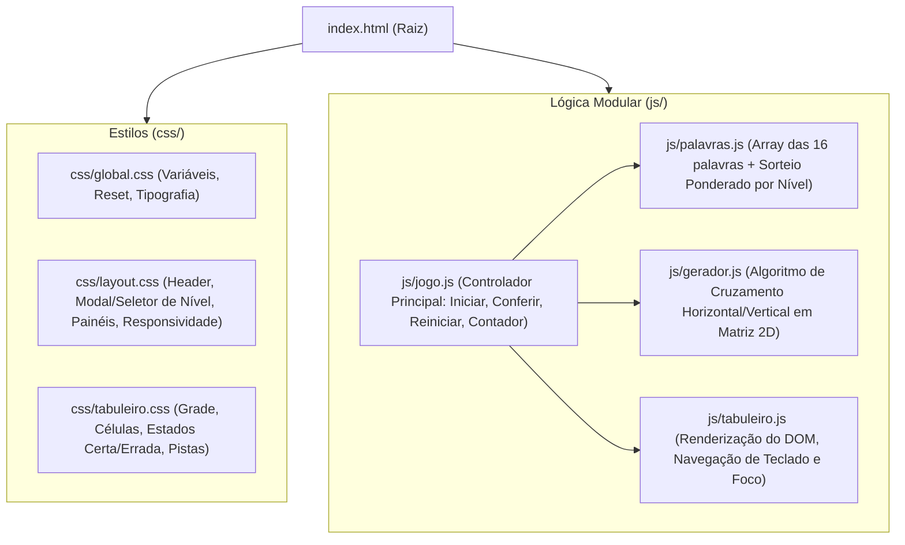

# Cruzadinha de Arquitetura Computacional

Mini-game estático de palavras cruzadas desenvolvido em **HTML5, CSS3 e JavaScript puros** para treinar os conceitos da disciplina de Arquitetura Computacional (SPTech).

> **Link do site publicado (GitHub Pages):** _Em breve (adicione aqui após publicar no GitHub Pages: `https://paraiso81.github.io/arqcomp-cruzadinha/`)_

---

## Como Jogar

1. Ao abrir o jogo, selecione o nível de dificuldade desejado:
   - **Fácil**: tabuleiro com **12 palavras** (priorizando palavras fáceis);
   - **Médio**: tabuleiro com **14 palavras** (priorizando médias e fáceis);
   - **Difícil**: tabuleiro completo com todas as **16 palavras**.
2. Leia as pistas numeradas nas colunas **Horizontais** e **Verticais** (ou clique em uma pista para destacar a palavra no tabuleiro).
3. Digite as letras diretamente nas casas do tabuleiro:
   - O cursor avança automaticamente para a próxima letra;
   - Use `Backspace` para apagar e voltar para a casa anterior;
   - Use as setas do teclado (`↑`, `↓`, `←`, `→`) para navegar ou clique novamente em um cruzamento para alternar entre horizontal e vertical.
4. Clique em **Conferir** para verificar quais palavras estão certas (verde) e erradas (vermelho) e atualizar o contador de acertos.
5. Clique em **Reiniciar** para limpar o tabuleiro atual ou em **Novo Tabuleiro** / **Trocar Nível** para gerar um novo cruzamento.

---

## Lista de Palavras e Pistas

| Nº | Termo | No Tabuleiro | Nível | Pista |
| :-: | :--- | :--- | :---: | :--- |
| 1 | CPU | `CPU` | Fácil | Responsável por executar instruções. |
| 2 | ULA | `ULA` | Fácil | Faz contas aritméticas e lógicas |
| 3 | UC (Unidade de Controle) | `UC` | Fácil | Lê cada instrução, descobre o que ela pede e envia as ordens para as outras partes |
| 4 | registradores | `REGISTRADORES` | Médio | Uma memória pequena que guarda o dado que esta sendo usado. |
| 5 | RAM | `RAM` | Fácil | Memória temporária que guarda os programas que estão rodando. |
| 6 | ROM | `ROM` | Fácil | Memória não volátil que guarda o que o computador precisa para iniciar |
| 7 | EEPROM | `EEPROM` | Difícil | Memória pequena não volátil que guarda dados que sobrevivem ao desligamento utilizada no arduino |
| 8 | Flash | `FLASH` | Fácil | Tipo de armazenamento não volátil, regravável em blocos, usado em SSDs e pendrives |
| 9 | cache | `CACHE` | Médio | Memória rápida e pequena que fica dentro da CPU. |
| 10 | memória de massa (armazenamento) | `MEMORIADEMASSA` | Difícil | Memória reposável por fazer a persistência dos dados. |
| 11 | DMA | `DMA` | Médio | Permite que um dispositivo tenha acesso direto a memória RAM. |
| 12 | address bus (barramento de endereço) | `ADDRESSBUS` | Difícil | Conjunto de linhas de comunicação físicas que permite à CPU especificar a localização exata na memória RAM |
| 13 | data bus (barramento de dados) | `DATABUS` | Difícil | Canal de comunicação bidirecional dentro de um computador responsável por transportar as informações. |
| 14 | microcontrolador | `MICROCONTROLADOR` | Difícil | Conjunto de um único chip CPU, memórias e dispositivos de entrada e saída. |
| 15 | dual core | `DUALCORE` | Médio | Um processador com dois núcleos. |
| 16 | quad core | `QUADCORE` | Médio | Um processador com quatro núcleos. |

---

# Plano de Implementação — Cruzadinha de Arquitetura Computacional

## Objetivo
Construir um mini-game web estático de palavras cruzadas sobre **Arquitetura Computacional** utilizando **HTML5, CSS3 e JavaScript puros**, cumprindo todos os requisitos do PDF da atividade avaliativa da SPTech e organizando o código de forma modular nas pastas `css/` e `js/`.

### Principais Funcionalidades Alinhadas
1. **Banco com as 16 palavras oficiais** em um array de objetos com `{ id, termo, palavra, nivel, pista }`, divididas de forma equilibrada entre `facil` (6), `medio` (5) e `dificil` (5), com pistas próprias para cada termo.
2. **Seleção de Nível antes de iniciar a partida (e troca rápida no topo)**:
   - **Fácil**: sorteia **12 palavras** priorizando as fáceis;
   - **Médio**: sorteia **14 palavras** priorizando médias e fáceis;
   - **Difícil**: seleciona todas as **16 palavras**.
3. **Motor Gerador de Cruzamentos Automático em JS**: calcula dinamicamente os cruzamentos na **horizontal** e **vertical** em uma matriz 2D para que todas as 12, 14 ou 16 palavras fiquem conectadas no tabuleiro sem coordenadas fixas.
4. **Usabilidade e Verificação**:
   - Digitação direta nas casas com avanço automático de letra, suporte a `Backspace`, setas do teclado e destaque da palavra ativa ao clicar na casa ou na pista.
   - **Botão Conferir**: destaca palavras certas (verde) e erradas (vermelho) tanto no tabuleiro quanto na lista de pistas e atualiza o contador (`"X de Y palavras"`).
   - **Botão Reiniciar**: limpa as letras digitadas mantendo o tabuleiro atual.
   - **Botão Novo Tabuleiro / Trocar Nível**: permite gerar uma nova disposição de cruzadinha ou mudar a dificuldade.

---

## Arquitetura e Particionamento de Arquivos



> [!NOTE]
> Os scripts são importados no `index.html` com `<script defer>` na ordem de dependência (`palavras.js` → `gerador.js` → `tabuleiro.js` → `jogo.js`), garantindo funcionamento imediato tanto abrindo o arquivo localmente (`file://`) quanto publicado no **GitHub Pages**.

---

## Mudanças Propostas por Componente

### 1. Estrutura Principal e Documentação (Raiz)

#### `[MODIFY]` [index.html](./index.html)
- Estrutura completa da página em `pt-BR`:
  - **Tela/Modal Inicial de Escolha de Nível**: Cartões para escolher **Fácil (12 palavras)**, **Médio (14 palavras)** ou **Difícil (16 palavras)** antes de começar.
  - **Header & Barra de Controles**:
    - Título do projeto + badge do nível atual;
    - Contador de acertos no padrão do PDF (`"0 de 12 palavras"`);
    - Botões **Conferir**, **Reiniciar**, **Novo Tabuleiro** e **Trocar Nível**.
  - **Layout Principal em 2 Colunas**:
    - **Coluna Esquerda**: Container da grade da cruzadinha (`#tabuleiro-grid`) e barra de dica da palavra selecionada no momento.
    - **Coluna Direita**: Painel dividido em **Horizontais** (`#lista-horizontais`) e **Verticais** (`#lista-verticais`), exibindo número, texto da pista e tag de dificuldade.

#### `[MODIFY]` [README.md](./README.md)
- Estruturação conforme a **Parte 3 do PDF**:
  - Nome do jogo e objetivo;
  - Como jogar (seleção de nível, digitação, conferência e reinício);
  - Tabela das 16 palavras com espaço para as pistas;
  - Plano completo de implementação;
  - Seção para o link do GitHub Pages (sem dados pessoais como RA, e-mail ou telefone).

---

### 2. Estilização Modular (`css/`)

#### `[MODIFY]` [css/global.css](./css/global.css)
- Variáveis CSS (`:root`) para o tema **Clean & Moderno (SPTech)**:
  - Cores base: fundo `#f4f6f9`, cards `#ffffff`, texto `#1b263b`, destaque institucional `#d90429` / `#00b4d8`;
  - Cores de validação: verde (`#2a9d8f`) para palavras certas e vermelho (`#e63946`) para palavras incorretas;
  - Cores para badges de nível (`facil`, `medio`, `dificil`).

#### `[NEW]` [css/layout.css](./css/layout.css)
- Estilos do cabeçalho, barra de status/contador, botões de ação, modal de seleção de dificuldade e grid principal responsivo (lado a lado no desktop e empilhado em telas menores).

#### `[NEW]` [css/tabuleiro.css](./css/tabuleiro.css)
- Estilos da matriz 2D da cruzadinha:
  - Células bloqueadas/vazias vs. células com `<input maxlength="1">`;
  - Número indicador no canto superior esquerdo da célula inicial de cada palavra;
  - Destaque visual da célula em foco e das demais casas da palavra selecionada;
  - Estados `.casa-correta` e `.casa-errada` no tabuleiro e `.pista-correta` / `.pista-errada` na lista lateral.

---

### 3. Dados, Algoritmo de Cruzamento e Controle (`js/`)

#### `[NEW]` [js/palavras.js](./js/palavras.js)
- Define o array `PALAVRAS_CRUZADINHA` com as **16 palavras do PDF**:
  - **Fácil (6)**: `CPU`, `ULA`, `UC`, `RAM`, `ROM`, `FLASH`
  - **Médio (5)**: `CACHE`, `REGISTRADORES`, `DMA`, `DUALCORE`, `QUADCORE`
  - **Difícil (5)**: `EEPROM`, `MEMORIADEMASSA`, `ADDRESSBUS`, `DATABUS`, `MICROCONTROLADOR`
- Exemplo de objeto no array:
  ```javascript
  {
    id: 1,
    termo: "CPU",
    palavra: "CPU",
    nivel: "facil",
    pista: "Responsável por executar instruções."
  }
  ```
- Função `sortearPalavrasPorNivel(nivel)`:
  - Embaralha cada grupo de dificuldade e seleciona a quantidade exata (**12** no Fácil, **14** no Médio, **16** no Difícil) priorizando o nível escolhido.

#### `[NEW]` [js/gerador.js](./js/gerador.js)
- Implementa o motor `gerarTabuleiroCruzadinha(palavrasSelecionadas)`:
  1. Ordena as palavras colocando uma palavra longa como base central e avaliando todas as interseções de letras possíveis na `horizontal` e `vertical`.
  2. **Regras de colisão e adjacência**:
     - Permite cruzamento apenas quando a célula já possui a mesma letra na direção perpendicular;
     - Proíbe que duas palavras fiquem coladas paralelamente ou em sequência na mesma linha/coluna sem espaço vazio entre elas;
     - Pontua cada encaixe candidato pela proximidade ao centro da matriz e pela quantidade de cruzamentos válidos.
  3. **Sistema de Multi-Tentativa (Retry com Backtracking Leve)**:
     - Caso uma disposição específica deixe alguma palavra sem encaixe válido, o algoritmo reordena as palavras restantes e refaz a tentativa automaticamente (até encontrar um tabuleiro onde **100% das 12, 14 ou 16 palavras** estejam posicionadas e cruzadas).
  4. Recorta as bordas vazias da matriz (`bounding box`) e atribui a numeração sequencial (`numero`) às casas iniciais de cada palavra (de cima para baixo, da esquerda para a direita).

#### `[NEW]` [js/tabuleiro.js](./js/tabuleiro.js)
- Renderiza os elementos `<input>` da matriz recortada e as listas de pistas Horizontais e Verticais.
- Controla a navegação inteligente:
  - Mantém o estado da direção atual (`horizontal` ou `vertical`);
  - Ao digitar uma letra válida (`A-Z`), preenche a casa em maiúsculo e move o foco para a próxima casa da palavra ativa;
  - Ao teclar `Backspace`, apaga a letra atual ou recua para a casa anterior da palavra;
  - Ao clicar duas vezes numa casa de cruzamento, alterna a direção ativa entre horizontal e vertical;
  - Ao clicar numa pista, destaca e foca a palavra correspondente no tabuleiro.

#### `[NEW]` [js/jogo.js](./js/jogo.js)
- Gerencia as ações principais:
  - `iniciarPartida(nivel)`: sorteia as palavras do nível, chama o gerador, renderiza tabuleiro + pistas e atualiza o contador para `"0 de X palavras"`.
  - `conferirRespostas()`:
    - Percorre todas as palavras posicionadas, lê as letras digitadas em suas coordenadas e compara com `palavra`;
    - Aplica classes `.correta` / `.errada` nas casas e nas pistas;
    - Atualiza o contador `"X de Y palavras"` e exibe feedback de vitória se `X === Y`.
  - `reiniciarTabuleiro()`: limpa todos os inputs, remove destaques de correção e restaura o contador para `"0 de X palavras"`.

---

## Plano de Verificação

### 1. Teste Automatizado do Algoritmo Gerador
- Executar um teste via Node.js validando 100 execuções seguidas do `gerarTabuleiroCruzadinha` para cada nível (`facil` = 12, `medio` = 14, `dificil` = 16), verificando que:
  - Todas as palavras sorteadas foram posicionadas (nenhuma palavra ficou de fora);
  - Cada palavra possui pelo menos 1 cruzamento com outra palavra;
  - Nenhuma letra foi sobrescrita incorretamente.

### 2. Verificação Visual e Funcional
- Abrir o jogo no navegador e validar:
  - Seleção de nível Fácil (12), Médio (14) e Difícil (16);
  - Pistas separadas em **Horizontais** e **Verticais**;
  - Digitação com avanço automático, `Backspace` e setas;
  - Botão **Conferir** marcando palavras certas e erradas e atualizando o contador `"X de Y palavras"`;
  - Botão **Reiniciar** limpando todas as casas do tabuleiro.
